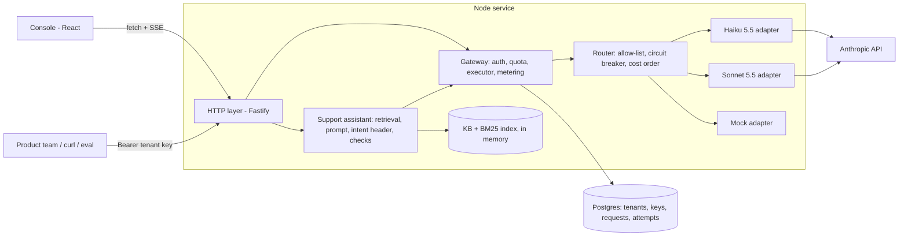
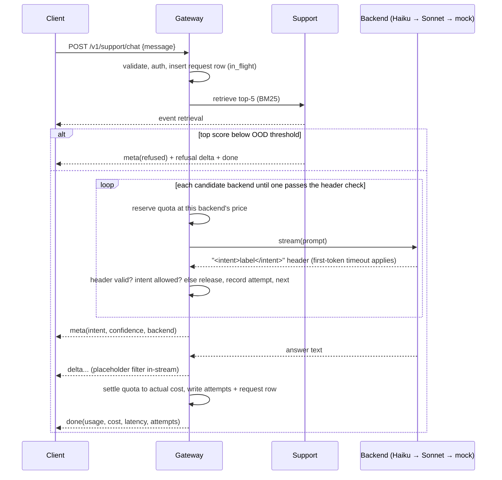

# Mini Inference Router: Design

The build contract for [the challenge](mini-inference-router-challenge.md). Evidence and trade-offs behind these choices are in the [study note](mini-inference-router-study.md). Written 2026-10-24.

## Shape

One Node.js (TypeScript) service on Render. It serves the API and the built React console from the same origin, and stores everything in Neon Postgres. The knowledge base and its search index live in memory.



## Endpoints

| Method and path | Auth | Purpose |
|---|---|---|
| `POST /v1/support/chat` | tenant key | The support capability. Streams SSE. |
| `POST /v1/chat` | tenant key | The raw gateway chat endpoint: `{messages, max_tokens?}`. Streams SSE, no retrieval. |
| `GET /v1/usage` | tenant key | Requests, cost and remaining quota for the caller's tenant. |
| `GET /admin/usage` | admin token | The same, for every tenant. Feeds the console's usage view. |
| `GET /admin/requests?tenant=&limit=` | admin token | Recent requests with their attempt trail. |
| `GET /healthz` | none | Liveness, used by the keep-warm pinger. |

Auth is `Authorization: Bearer <key>`. Tenant keys look like `mir_<32 random base62 chars>` and are stored as SHA-256 hashes. A slow hash isn't needed for high-entropy random keys. The admin token is an env var, compared in constant time.

Quota is checked before the stream opens (the cheapest allowed backend must fit), so an exhausted tenant gets a real 429. Each attempt still reserves atomically inside the stream; if a race loses that reservation on every backend, the stream ends with an `error` event `quota_exceeded`.

Errors before the stream starts are plain JSON with a status code, never SSE:

| Case | Status | Body |
|---|---|---|
| Malformed body | 400 | `{error:"invalid_request", issues:[...]}` |
| Missing, unknown or revoked key | 401 | `{error:"unauthorized"}` |
| Quota can't cover the request | 429 | `{error:"quota_exceeded", remaining_usd}` |
| Database unreachable | 503 | `{error:"unavailable"}` (fail closed) |

## SSE protocol

Every event is `event: <name>\ndata: <json>\n\n`. Order: `retrieval` → `meta` → `delta`* → `done`. `error` may appear before `done`. `retrieval` is sent only on the support route.

| Event | Data |
|---|---|
| `retrieval` | `{request_id, entries:[{id, intent, question, score}], retrieval_intent, votes, top_score}` |
| `meta` | `{request_id, intent, confidence:{score, level, votes, agrees}, backend, model, refused, refusal_reason}` |
| `delta` | `{text}` |
| `error` | `{code, message}`: a failure after the first delta. No fallback is possible then. |
| `done` | `{request_id, outcome, backend, usage:{input_tokens, output_tokens, estimated}, cost_usd, latency_ms, ttft_ms, attempts:[{backend, outcome, ttft_ms, latency_ms, error}]}` |

A refusal is a normal stream: `meta` with `refused: true`, one `delta` carrying the refusal text, then `done`.

## Support request lifecycle



### Intent comes from the model, in a header

The model is told to begin its reply with `<intent>label</intent>`, using one of the 27 intent labels or `out_of_scope`, and then write the answer. The gateway holds back the stream until the closing tag arrives, parses it, then sends `meta` and starts forwarding the answer.

Why (recommended): one model call per request, intent known before the first answer token, and a malformed header becomes a clean "unusable output" case that can still fall back, because nothing has reached the client yet. It also makes the two eval configurations differ on intent accuracy. With retrieval-only intent, both would score the same.

The header check fails, and the attempt falls back, if:
- no closing tag within 80 characters;
- the label isn't one of the 27 intents or `out_of_scope`.

### Confidence and refusal

- **Retrieval votes:** how many of the top 5 retrieved entries carry each intent.
- **`score`:** the share of the top 5 that agree with the model's intent (0–1). `agrees` is true when the model's intent matches the retrieval majority. `level` is `high` at ≥ 0.8, `medium` at ≥ 0.4, otherwise `low`.

The assistant refuses, without guessing, in three cases:
1. **Before any model call:** the top BM25 score is below the out-of-domain threshold `τ = 4`. This costs no tokens, and the request row has `outcome = refused_low_confidence` and no backend. On the dev slice, τ = 4 gives 0.3% false refusals and catches 4 of 5 dev out-of-domain questions (`scripts/tune.ts`); the rest rely on the model's `out_of_scope` label.
2. **The model says `out_of_scope`.** Outcome `refused_out_of_scope`.
3. **`level` is `low`:** the model's intent has at most 1 of the 5 retrieved votes. The model's answer is discarded before any of it is sent. Outcome `refused_low_confidence`.

`τ` and the vote cut-off are tuned on a dev slice and dev out-of-domain questions, never on the 30 eval cases.

A model safety refusal (`stop_reason: "refusal"`) ends the request with outcome `refused_by_model` and does not fall back. Sending a declined message on to another model would be shopping for one that answers it.

### Unusable output

| Where | Problem | Handling |
|---|---|---|
| Before the first delta | Provider error, timeout, bad header, empty output, `max_tokens` before any text | Record the attempt, release its reservation, try the next backend |
| Before the first delta | `stop_reason: "refusal"` | Terminal, `refused_by_model` |
| Mid-stream | `{{...}}` placeholder | An in-stream filter holds text after `{{` until `}}` and replaces it with the demo company profile value, or a neutral phrase. Marked `sanitized` |
| Mid-stream | Provider error or total timeout | `error` event, outcome `partial`, settle what was used |
| Mid-stream | Client disconnects | Abort the provider stream, outcome `client_aborted`, settle what was used |

## Routing

The candidate list per request is the tenant's `route` (default `["haiku", "sonnet", "mock"]`), filtered by:

1. **Allow-list:** the tenant's `route` is its allow-list and its order.
2. **Circuit breaker:** in memory, per backend. Open after 3 consecutive failures, skip for 30 s, then let one trial request through.
3. **Cost order:** Haiku ($0.10/$0.50) before Sonnet ($2/$10) before mock ($0). The cheapest model that does the job goes first. The eval checks that Sonnet isn't measurably better on this task.

Each route entry can override `first_token_ms` and `total_ms`. The mock entry can set `latency_ms` and `fail_rate`. Demo tenants use this to show fallback with real timeouts and no fault-injection code.

Error classification per attempt:

| Provider result | Attempt outcome | Next step |
|---|---|---|
| No first token within `first_token_ms` (default 4 s Haiku, 6 s Sonnet) | `timeout_first_token` | next backend |
| 429 `rate_limit_error` | `rate_limited` | next backend (separate pool per model) |
| 529 `overloaded_error`, 5xx, network error | `provider_error` | next backend |
| 401, 403, 402, 400 spend limit, 429 `enforced_spend_limit_reached` | `account_error` | skip every Anthropic backend, go to mock |
| Other 400 | `bad_request` | next backend (the request shape differs per model) |
| Header check fails | `unusable_output` | next backend |
| Reservation fails for this backend | `skipped_quota` | next backend. The first candidate failing gives a 429 to the client |
| Circuit open | `circuit_open` | next backend |
| An earlier attempt had `account_error` | `skipped_account` | next backend (Anthropic ones skipped) |

The SDK client runs with `maxRetries: 0`. Retries and fallback belong to the gateway. Hidden SDK retries would distort latency and break the first-token timeout.

## Quota and metering

Quota is a cost budget in micro-dollars per tenant, not tokens: Sonnet costs 20× Haiku, and the two tokenizers differ. It's a fixed budget, reset by a script (cut: no monthly periods).

- **Reserve**, per attempt, at that backend's price for the estimated input plus `max_tokens` output:
  `UPDATE tenants SET used_micros = used_micros + $r WHERE id = $t AND used_micros + $r <= quota_micros RETURNING used_micros`.
  No row returned means the reservation failed.
- **Release** the reservation when the attempt fails.
- **Settle** at the end: subtract the reservation, add the actual cost.
- **Crash safety:** at boot, any `in_flight` request older than the process start has its reservation released and is marked `aborted`. There's a single instance, so every in-flight row at boot is dead.

Usage comes from the provider: `message_start.usage.input_tokens` and the final `message_delta.usage.output_tokens`. When a stream breaks before the final usage arrives, output tokens are estimated as characters ÷ 4 and marked `estimated`. The mock always estimates.

Failed attempts can cost money: the provider may bill input it already processed. Each attempt records any usage it received, and the request cost is the sum over its attempts.

## Data model

```sql
create table tenants (
  id text primary key,
  name text not null,
  quota_micros bigint not null,
  used_micros bigint not null default 0,
  route jsonb not null default '[{"backend":"haiku"},{"backend":"sonnet"},{"backend":"mock"}]',
  created_at timestamptz not null default now()
);
create table api_keys (
  id bigserial primary key,
  tenant_id text not null references tenants(id),
  key_hash bytea not null unique,
  prefix text not null,
  revoked_at timestamptz,
  created_at timestamptz not null default now()
);
create table requests (
  id uuid primary key,
  tenant_id text not null references tenants(id),
  endpoint text not null,
  status text not null,              -- in_flight | finished | aborted
  outcome text,                      -- ok | refused_low_confidence | refused_out_of_scope | refused_by_model | partial | failed | client_aborted | quota_exceeded
  backend text, model text,
  intent text, confidence real,
  input_tokens int, output_tokens int, usage_estimated bool,
  cost_micros bigint not null default 0,
  reserved_micros bigint not null default 0,
  ttft_ms int, latency_ms int,
  fallback boolean not null default false,
  sanitized boolean not null default false,
  error text,
  created_at timestamptz not null default now(),
  finished_at timestamptz
);
create table request_attempts (
  request_id uuid not null references requests(id),
  seq int not null,
  backend text not null,
  outcome text not null,
  ttft_ms int, latency_ms int,
  input_tokens int, output_tokens int, cost_micros bigint not null default 0,
  error text,
  primary key (request_id, seq)
);
create index on requests (tenant_id, created_at desc);
```

Unauthenticated requests have no tenant, so they're logged but get no row.

## Backends

```ts
interface Backend {
  id: "haiku" | "sonnet" | "mock";
  model: string;
  price: { inPerM: number; outPerM: number };
  stream(req: { system: string; messages: Msg[]; maxTokens: number }, signal: AbortSignal): AsyncIterable<Chunk>;
}
type Chunk =
  | { type: "text"; text: string }
  | { type: "usage"; input?: number; output?: number }
  | { type: "stop"; reason: string };
```

Per-model request fields (from the docs, checked by spike 1):

| | Haiku 5.5 | Sonnet 5.5 |
|---|---|---|
| `model` | `claude-haiku-5-5` | `claude-sonnet-5-5` |
| `thinking` | `{type: "disabled"}` | `{type: "between_tools"}` (`disabled` returns 400) |
| `output_config.effort` | `low` | `low` |
| Sampling parameters | none (400) | none (400) |

**Mock:** an extractive answer. It writes the header with the retrieval-majority intent, then streams the top retrieved answer (placeholders filled) in about 8-character chunks. Latency and failure rate come from the route entry. On `/v1/chat` it echoes a canned reply.

## Retrieval and data

- `scripts/make_split.py` (Python, offline, fixed seed) reuses the study's deduplication and the cos < 0.8 filter. It writes:
  - `data/kb.jsonl`: 2,000 rows, ~74 per intent;
  - `data/eval.jsonl`: 27 cases, one per intent, plus 3 keyword-style (flag K);
  - `data/dev.jsonl`: 300 cases for tuning `τ`.
- `data/ood_eval.jsonl` (5) and `data/ood_dev.jsonl` (5) are hand-written out-of-domain questions.
- The index is MiniSearch (BM25, prefix matching), built at boot over the KB questions, with English function words dropped. The intent vote over the top 5 is weighted by score. Measured on dev: 90.6% retrieval-only intent accuracy (86.5% before stopwords and weighting).
- The prompt is the system prompt (role, the 27 labels, header format, "only use the retrieved answers") plus the five retrieved question/answer pairs with placeholders filled, then the customer's message. About 1,100 tokens.

## Console

React and Vite, built into `web/dist` and served by the Node service.

- **Playground:** paste a tenant key, type a message, watch the answer stream. A side panel shows the backend and model, whether fallback fired (with the attempt trail), the retrieved entries, the intent and confidence, tokens, latency and cost.
- **Usage:** paste the admin token. A table per tenant shows requests, cost and remaining quota, plus recent requests with their attempt trail.
- SSE is read with `fetch` and a stream parser, because `EventSource` can't send POST bodies or auth headers.

## Evaluation

`npm run eval -- --tenant eval-haiku` and `--tenant eval-sonnet` call the running service over HTTP, so the measured latency is the real path. Each eval tenant's route pins one backend with no fallback, so a configuration is just a tenant and needs no eval-only code path.

| Metric | How it's measured |
|---|---|
| Intent accuracy | Against the label, with a Wilson 95% interval. Retrieval-only accuracy is shown alongside as the reference line |
| Answer quality | Claude Opus 5.5 as judge, 3 yes/no checks: addresses the request; no invented facts or leftover placeholders; refuses when it should. 10 cases hand-checked against the judge |
| Refusals | Refusal rate on the 5 out-of-domain cases, false-refusal rate on the 30 in-domain |
| Latency | Time to first token and total, p50 and p95, from the client side |
| Cost | Summed from `done` events, cross-checked against the `requests` rows |
| Comparison | Discordant pairs between the two configurations |

Output: `eval/results/<tenant>.json` and a markdown table that goes into the report.

## Repository layout

```
server/src/   index.ts config.ts http/ gateway/ backends/ support/ db/
server/test/  vitest, run against local Postgres
web/src/      App.tsx Playground.tsx Usage.tsx sse.ts
data/         kb.jsonl eval.jsonl dev.jsonl ood_*.jsonl
eval/         run.ts judge.ts results/
scripts/      make_split.py seed.ts
render.yaml   one web service; env DATABASE_URL, ANTHROPIC_API_KEY, ADMIN_TOKEN
```

## Seeded tenants

| Tenant | Route | Shows |
|---|---|---|
| `acme` | Haiku → Sonnet → mock | The normal path |
| `slow-haiku` | Haiku (`first_token_ms: 50`) → Sonnet → mock | A real timeout falling back to Sonnet |
| `outage` | Haiku (50 ms) → Sonnet (50 ms) → mock | The last resort serving |
| `flaky-mock` | mock (`fail_rate: 0.5`, `latency_ms: 800`) → Haiku | Configurable failure and latency |
| `tiny` | default, $0.001 quota | Quota failing closed |
| `eval-haiku`, `eval-sonnet` | one backend each | Eval configurations |

## Cut (stated in the report)

- No tenant-management UI: tenants and keys come from the seed script.
- No monthly quota periods.
- No per-minute rate limits.
- No embeddings or vector database.
- No multi-turn memory.
- No mid-stream recovery.
- Circuit-breaker state is in memory, on a single instance.
- No console login beyond pasting a key.
- No prompt caching: the prompt is about 1,100 tokens.
